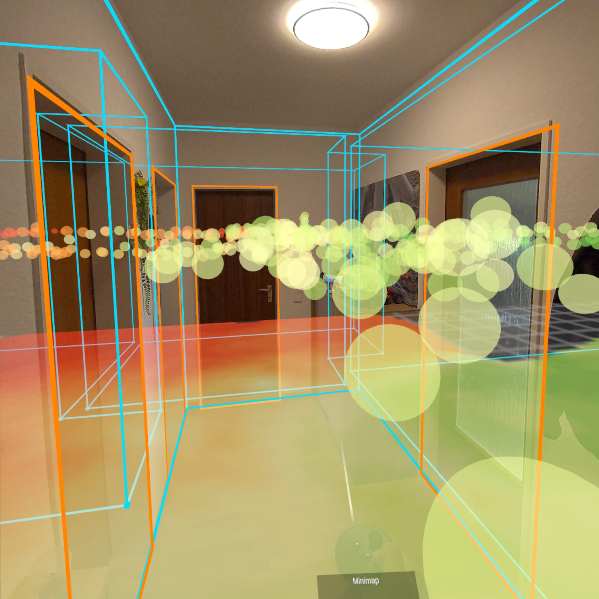
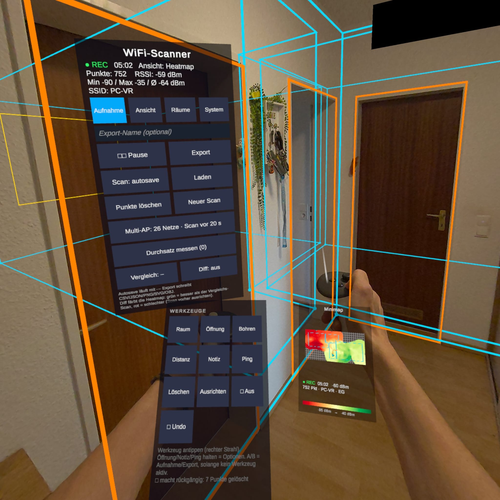
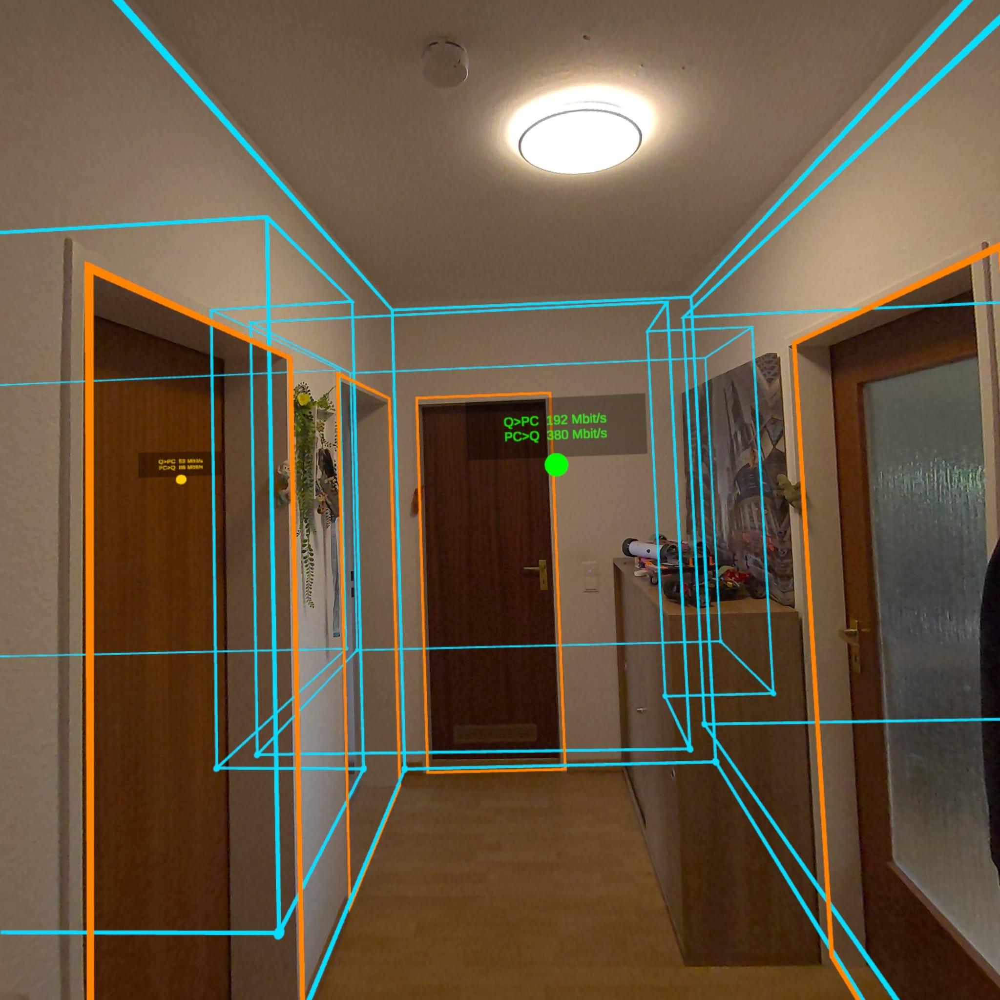
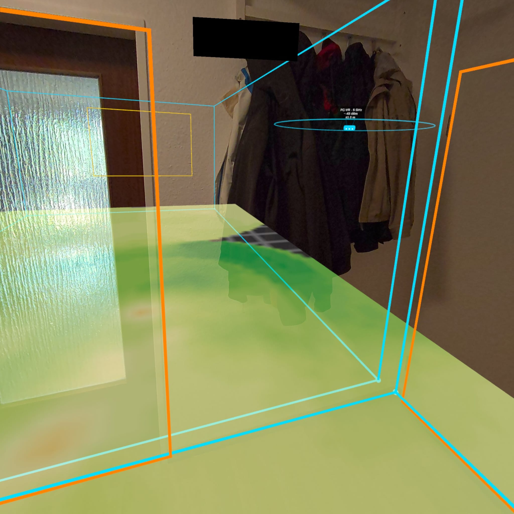
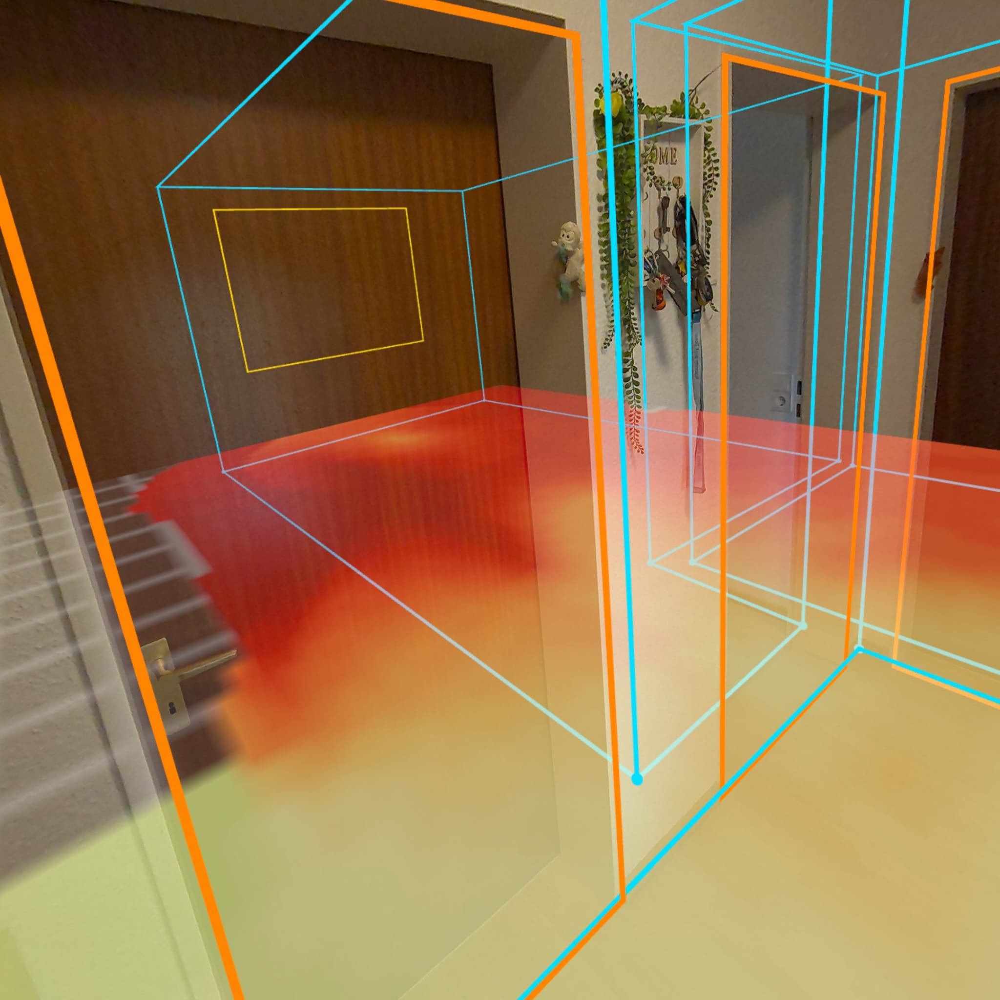
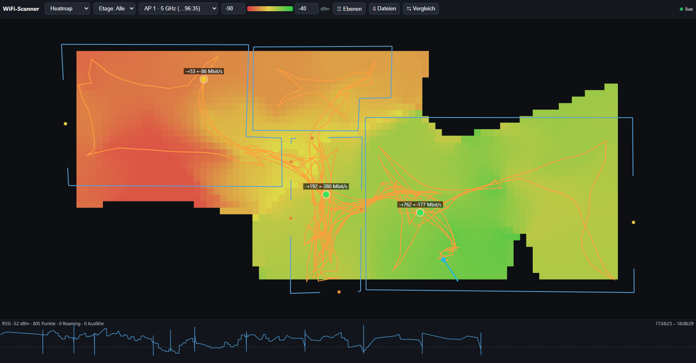
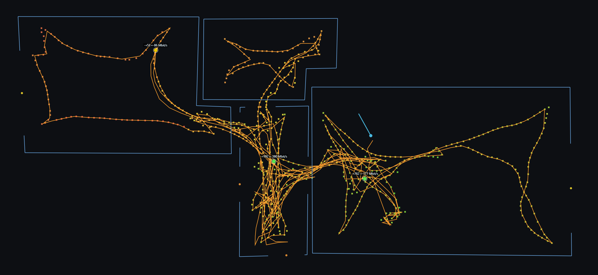
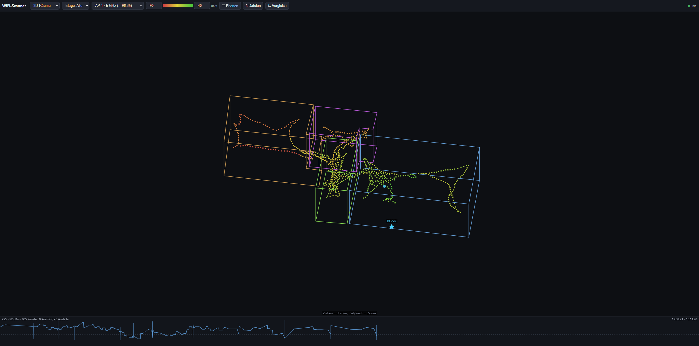

# Quest 3 WiFi Scanner

A native Meta Quest 3 / 3S app (Unity 6, **OpenXR + Meta OpenXR / AR Foundation**)
that reads the signal strength (RSSI) of the **connected** Wi-Fi access point
and ties every reading to the headset's 3D position. As you walk through a
building, the app builds up in **mixed-reality passthrough**:

- a **3D point cloud** colored by RSSI,
- an **interpolated floor heatmap** (IDW) that shows unmeasured areas as gray
  gaps,
- a **guided survey layer** that tracks progress and measurement confidence
  per room cell,
- a **hand-drawn, to-scale floor plan** with room heights, doors and windows,
  plus optional drill, measurement, ping and note markers,
- a **wrist minimap** and a **web dashboard** served directly from the Quest,
- optionally a **continuously updated room mesh from environment depth**, no
  Space Setup required,
- a **local bidirectional throughput test** against the dashboard browser,
  plus downloads and exports over the local network.

No Meta Space Setup room scan is needed. Virtual points and the heatmap still
disappear behind real objects: occlusion runs in real time on the Quest depth
API. The same depth API can optionally drive the dynamic room scan. Scanning
and mesh visibility are two independent toggles; the expensive scan is off by
default.

> **Why native and not WebXR?** Browsers and WebXR have no API for Wi-Fi RSSI
> in dBm. That information is only available through native Android APIs
> (`WifiManager`).

The in-headset UI is available in **English and German**. It follows the
system language and can be switched in the *System* tab of the control panel.

---

## Impressions from the Quest

<table>
  <tr>
    <td width="50%"><br><sub>Heatmap and RSSI point cloud in the real room</sub></td>
    <td width="50%"><br><sub>World-space control panel and wrist minimap</sub></td>
  </tr>
  <tr>
    <td width="50%"><br><sub>Bidirectional throughput markers inside the building</sub></td>
    <td width="50%"><br><sub>Estimated AP location with distance and signal strength</sub></td>
  </tr>
  <tr>
    <td colspan="2"><br><sub>Room geometry, windows and Wi-Fi heatmap in passthrough</sub></td>
  </tr>
</table>

---

## Features

**Measuring**

- **Live Wi-Fi readings** of the connected AP: RSSI, link speed, frequency,
  SSID, BSSID and floor.
- **Multi-AP scanning**: optionally records all visible neighboring access
  points. Every BSSID gets its own measurements, heatmap filter and location
  estimate.
- **Roaming tracking**: detects BSSID or band changes (e.g. in mesh networks)
  while recording, marks them in space and exports them.
- **Throughput test**: measures the local link Quest → browser and
  browser → Quest and places the result as a spatial marker.
- **Ping nodes**: TCP latency measurements placed in the room, against a
  configurable host.

**Visualizing**

- **3D point cloud** with constant point density: nearby revisits update a
  running average instead of duplicating points.
- **Floor heatmap** per floor: IDW interpolation, gap grid, opacity and RSSI
  range filter.
- **Guided survey**: rooms are split into aligned cells. Switch the layer
  between RSSI, *Progress* and *Measurement confidence*. Confidence takes
  density, distance, RSSI stability, age and tracking quality into account
  without mixing them into the raw RSSI heatmap. Cells blocked by furniture or
  walls can be marked unwalkable with a dedicated tool. The live view and the
  report use the same criteria.
- **Before/after comparison**: diff the current session against a saved scan
  (green = better, red = worse), e.g. after moving an AP.
- **Coverage prediction**: real-time path-loss prediction from the floor plan
  (walls, doors, windows) for a real (fixed) or virtually placed AP.
- **Wall attenuation estimate** per wall, shown in AR and exported as SVG.
- **AP location estimate** with uncertainty circles, for one or many BSSIDs.
- **Dynamic occlusion**: environment depth hides points and heatmap behind
  real objects, without a room scan.
- **Dynamic room mesh**: optional environment-depth scan using a sparse TSDF,
  Surface Nets and chunked updates. The mesh can be tinted by nearby RSSI.
  Turning the scan off fully stops depth requests, integration and meshing;
  hiding the mesh does not stop the scan.
- **Wrist minimap** (left wrist): heatmap, floor plan, head position and view
  direction, north-up or rotating, zoomable with the right stick.
- **Geiger audio**: optional RSSI audio feedback; a stronger signal produces
  faster, higher-pitched blips.

**Mapping**

- **Room tracer**: place corners, move corners, drag room height, calibrate
  the floor, name rooms.
- **Doors and windows**: openings are shown in AR, drawn as wall gaps in SVG
  and cut as real holes into the OBJ walls.
- **Grid alignment**: align the heatmap grid to a real wall with a
  two-controller line.
- **Multiple floors**: samples are assigned to the active floor. Basements,
  upper floors and label shifting are supported, as are filtered views.
- **Analysis tools** on the left-wrist palette: drill planner, distance
  measurement, spatial notes, ping nodes, survey cells, universal delete mode
  and a global **undo**.

**Sessions**

- **Autosave and resume**: on start, the app offers to continue the last
  session.
- **Load and align**: saved scans can be reloaded on the Quest and snapped onto
  the current tracking origin using a real wall. Samples, rooms, floors, grid
  orientation and all tool sidecars move together.
- **First-run tutorial** covering floor calibration, room tracing, recording
  and export.
- **Live streaming**: embedded web dashboard plus an optional UDP stream to
  `tools/receiver.py`.

---

## Exported data

On export, the app writes to `Application.persistentDataPath`:

| File | Content |
|---|---|
| `<stem>.csv`, `<stem>.json` | All samples. The JSON also stores `floors` and `gridYawDegrees`. |
| `<stem>_heatmap.png` + `.json` | Heatmap of the active floor with georeference |
| `<stem>_heatmap_<floor>.png` + `.json` | Heatmap and georeference for every floor |
| `<stem>_survey_<floor>.json` + `.png` | Survey cells, progress, confidence and completion state per floor |
| `<stem>_rooms.svg`, `<stem>_rooms.json` | Floor plan |
| `<stem>_rooms.obj` | Extruded room walls with door and window holes |
| `<stem>_walls.svg` | Floor plan labeled with wall attenuation in dB |
| `<stem>_combined.svg` | Heatmap and floor plan combined |
| `<stem>_coverage.png` + `.json` | Simulated coverage prediction |
| `<stem>_roam.json` | Recorded roaming events |
| `<stem>_roommesh.obj` | Dynamically captured room mesh |
| `<stem>_report.html` | Self-contained survey report with findings |
| `<stem>_drill/_apfix/_ping/_notes/_measure/_throughput.json` | Optional tool sidecars |
| `wifi_autosave.*` | Periodically overwritten autosave |

When a session is reloaded, all sidecars are restored and transformed together
by the scan aligner.

The web dashboard can also render a formatted HTML report that combines all
data, with automatically generated findings per room. See the
[example report (HTML)](assets/Example-Report.html) or the preview:


---

## Project structure

```text
Wifi-Scanner/Assets/
  Scripts/
    Sample.cs                      Sample data model (+ CSV/JSON)
    WifiReader.cs                  Android WifiManager bridge (JNI)
    WifiScan.cs                    Scan results of all visible APs
    SampleCollector.cs             Recording, smoothing, spatial hash, export facade
    MultiApScanner.cs              Feeds neighboring BSSIDs into the pipeline
    RoamingTracker.cs              BSSID/band change detection
    HeatmapColorMapper.cs          RSSI -> color (RdYlGn)
    HeatmapLegend.cs               Color legend texture
    PointCloudRenderer.cs          3D point cloud, pooling, filters, floor filter
    FloorHeatmapRenderer.cs        Floor heatmap, IDW, gaps, diff view, PNG export
    VisualizationModeController.cs Point cloud / heatmap / both / off
    SurveyAnalyzer.cs              Room rasterization and survey findings
    SurveyPlanController.cs        Guided survey plan and AR quality layer
    SurveyCellTool.cs              Mark survey cells walkable/unwalkable
    CoverageSimulator.cs           Path-loss coverage prediction
    WallLossEstimator.cs           Per-wall attenuation estimate
    ApLocator.cs                   AP location estimate
    FloorManager.cs                Floors, floor switching, labels
    RoomTracer.cs                  Floor plan, corners, heights, floor calibration
    OpeningTool.cs                 Doors and windows in traced walls
    GridCalibrator.cs              Align the grid to a wall
    MinimapController.cs           Wrist minimap
    DynamicOcclusionController.cs  Environment depth occlusion
    DynamicRoomMeshController.cs   Room mesh start/stop, visibility, chunks, OBJ export
    DynamicRoomMesh/               TSDF, Surface Nets and mesh decimation
    ControlPanel.cs                World-space control panel
    ToolPalette.cs                 Left-wrist tool palette
    UiBuilder.cs, XrUiHover.cs     Shared runtime UI building blocks
    LocalizationManager.cs         English/German UI, report and dashboard strings
    OnboardingGuide.cs             First-run tutorial
    ResumePrompt.cs                Resume-autosave prompt
    UndoStack.cs                   Global undo
    RecordingControls.cs           A/B controller shortcuts
    OpacityControls.cs             Opacity via thumbstick
    SessionLoader.cs               List, load and re-stream scans
    ScanAligner.cs                 Align loaded scans to a real wall
    GeigerCounter.cs               RSSI audio feedback
    PingTester.cs                  TCP latency nodes
    ThroughputTester.cs            Spatial throughput markers
    SpatialNoteManager.cs          Spatial notes
    DistanceMeasurer.cs            Distance measurements
    DrillPlanner.cs                Drill lines on room surfaces
    DeleteController.cs            Universal delete mode
    WebDashboardServer.cs          Embedded HTTP/WebSocket server
    WebDashboardPage.cs            Self-contained browser dashboard
    ReportGenerator.cs             HTML survey report
    DataExporter.cs                CSV/JSON/PNG/SVG/OBJ export and load APIs
    NetworkStreamer.cs             UDP + dashboard fan-out
    CsiPoseStreamer.cs             Headset pose stream for Wi-Fi CSI tracking labels
    PassthroughSetup.cs            MR passthrough + boundaryless
    SceneBootstrap.cs              Runtime creation and wiring
    WifiProbe.cs                   Standalone Wi-Fi device test
  Editor/
    SurveyAnalyzerRegressionTests.cs
  Resources/DynamicRoomMesh/       Depth/TSDF compute kernels and mesh shaders
  PointMat.mat / FloorHeatMat.mat  Material assets (prevent shader stripping)
  Plugins/Android/AndroidManifest.xml  Permissions + GameActivity

tools/
  receiver.py                      PC GUI for live and offline viewing
  mesh_to_floorplan.py             Derive a 2D wall plan (SVG/JSON) from a room mesh OBJ
  pull_scans.ps1                   Pull exported files from the Quest
```

---

## Setup

### Requirements

- Unity 6 (project uses 6000.3) with Android Build Support (OpenJDK, SDK, NDK)
- Packages from the manifest, notably:
  `com.unity.xr.openxr`, `com.unity.xr.meta-openxr`,
  `com.unity.xr.arfoundation`, `com.unity.xr.interaction.toolkit`,
  `com.unity.xr.hands`
- Quest 3 / 3S in developer mode with USB debugging allowed

### Project settings

Project Settings → XR Plug-in Management → **OpenXR → Android**: enable the
**Meta Quest** feature group and these features:

1. **Meta Quest: Session**
2. **Meta Quest: Camera (Passthrough)**
3. **Meta Quest: Boundary Visibility**
4. **Meta Quest: Meshing**
5. **Meta Quest: Occlusion**

`Meshing` stays enabled even though no static Space Setup mesh is used: it
provides the `USE_SCENE` permission that the depth/occlusion pipeline needs.

### Scene

`Assets/Scenes/SampleScene.unity` is ready to use: XR Origin, `SceneBootstrap`
with material assets, and `PassthroughSetup`. For the optional UDP live stream,
set the PC IP on `SceneBootstrap` or later in the control panel.

### URP magenta pitfall

Materials created at runtime with `Shader.Find` easily lose their shader
variant in Android builds and render magenta. That is why `PointMat` and
`FloorHeatMat` are real material assets referenced by `SceneBootstrap`.

---

## Usage

The app starts in passthrough with recording paused. Start recording
deliberately with the A button or the panel. A full menu reference is in the
[user manual](manual_eng.md) ([PDF](manual_eng.pdf)).

### Controllers

| Input | Action |
|---|---|
| A (right) | Pause/resume recording |
| B (right) | Export |
| Right trigger | Click UI / perform the active tool action |
| Left stick up/down | Opacity of point cloud and heatmap |
| Right stick up/down | Zoom minimap (drill depth while drilling) |
| Right stick click | Cycle view: point cloud → heatmap → both |
| Y (left) | Show/hide minimap |
| Menu button (left) | Show/hide control panel |
| Right grip over the panel | Grab and place the panel; it then turns to face you |
| Long press on a palette tool | Open tool options (door/window, note type, ping host) |
| Both grips | Confirm grid calibration or scan alignment |
| Room tool: trigger / B / A | Place corner / close room / remove last corner |

Active tools take over A/B where they would otherwise cause mistakes.

### Control panel

The world-space panel is operated with the controller ray and has four tabs:

- **Scan**: export name, record/pause, export, new scan (with "export first"
  prompt), load scans, clear points, multi-AP scan, throughput test, guided
  survey, before/after comparison.
- **View**: view mode, occlusion, room scan and room mesh visibility, minimap
  and floor plan overlay, map rotation, AP location and AP filter, roaming
  markers, throughput markers, audio, coverage prediction, opacity, RSSI
  filter.
- **Rooms**: grid alignment, floor calibration, delete rooms, remove last
  opening, name rooms, wall attenuation, floors (select, create, shift labels),
  clear measurements/notes/pings.
- **System**: PC IP for UDP stream, web dashboard on/off with URL, delete all
  scans on the device, language, restart tutorial.

### Left-wrist tool palette

Room, opening, drill, distance, note, ping, survey cells, delete, align, tools
off, and undo. Only one placement tool is active at a time; its instructions
appear on the palette.

---

## Tracing rooms

The floor plan is drawn by hand in AR, without Space Setup:

1. Select **Room** on the wrist palette.
2. Place corners one by one with the right controller.
3. Close with B, or snap near the first corner and close with the trigger.
4. Edit finished rooms in the same tool:
   - aim at a corner and drag it
   - aim at the floor, hold the trigger and drag up to set room height

Rooms with a height are exported as OBJ walls. Floors and ceilings are
deliberately left open so that complex, concave layouts stay robust.

### Doors and windows

The **Opening** tool works on existing walls (the room needs a height):

- Door: first press sets the upper corner on the hinge side, the second sets
  the width. The height extends to the floor automatically.
- Window: set two opposite corners of the rectangle.
- A switches between door and window, B removes the last opening.

SVG exports draw wall gaps with symbols; OBJ exports cut real openings into the
wall geometry.

---

## Loading and aligning sessions

Saved scans can be reloaded from the panel. This restores samples, rooms
(including heights and openings), floors, grid orientation and all tool
sidecars (drill lines, ping nodes, throughput points, notes, measurements).

Because the Quest may reset its tracking origin on every launch, old world
coordinates rarely line up with the real room. Use **Align**:

1. Aim at a loaded room that has a height.
2. Select a wall of the loaded floor plan with the trigger.
3. Hold the left controller at the real anchor corner.
4. Point the right controller along the real wall.
5. Hold both grips, check the preview, release.

The app rotates and moves the entire session.

---

## Web dashboard and PC viewer

### Embedded web dashboard

When enabled, the Quest serves a local page:

```text
http://<quest-ip>:8080
```

It shows live:

- samples or a client-side 2D heatmap
- coverage prediction (walls, virtual and real APs)
- walking path and current head position
- rooms with doors and windows
- AP locations (multiple BSSIDs)
- roaming events, ping nodes, throughput points and notes
- floor filter and an interactive 3D view

**Interpolated Wi-Fi heatmap with floor plan, walking path and throughput points**



**Individual RSSI samples and recorded walking path**



**Interactive 3D room view with floors and spatial point cloud**



It also provides a scan list, single-file downloads, a ZIP of all exports, an
export trigger from the browser and the HTML report. The dashboard page is the
counterpart for the throughput test, so keep it open while measuring.

> **Note:** The dashboard is meant for a trusted local network. It currently
> has no PIN or read-only mode.

### Python receiver

`tools/receiver.py` receives the same live stream over UDP and shows 2D/3D
views on the PC. It also handles live rooms, drill lines, AP fix, ping nodes,
notes and clear packets on session reload.

### Floor plan from the room mesh

`tools/mesh_to_floorplan.py` derives a 2D wall plan from an exported
`_roommesh.obj`:

```bash
python tools/mesh_to_floorplan.py scan_roommesh.obj -o plan --resolution 0.04
```

---

## Getting data off the device

With the script:

```powershell
.\tools\pull_scans.ps1
```

Or directly with ADB:

```bash
adb pull /sdcard/Android/data/com.pwrcore.wifiscanner/files/ ./
```

The web dashboard can also download exports individually or as a ZIP.

---

## Known limitations

- **Wi-Fi permission:** `ACCESS_FINE_LOCATION` must be granted, otherwise
  SSID/BSSID are redacted and RSSI may be useless (`<unknown ssid>`,
  `-127` dBm).
- **Android API:** `WifiManager.getConnectionInfo()` is deprecated since
  API 31 but works on tested Quest OS versions. If an OS update blocks it,
  `WifiReader.cs` must move to `ConnectivityManager` + `NetworkCallback` +
  `getTransportInfo()`.
- **Tracking drift:** long scans across many rooms can drift. Don't recenter
  while recording, and use the scan aligner for reloaded scans.
- **RSSI noise:** RSSI fluctuates by several dB. `smoothingWindow` smooths
  readings, and revisited points are updated with a running average.
- **Multiple floors:** the live heatmap shows the active floor; export writes
  heatmap PNGs and georeference JSONs for every floor.
- **Editor:** passthrough, dynamic occlusion and real Wi-Fi data only work in
  the Android build. In the editor, `WifiReader` returns fake values so UI,
  point cloud, heatmap and filters remain testable.

---

## Roadmap

1. Optional PIN and read-only mode for the web dashboard.
2. Document more device test runs with different room sizes, floors and Wi-Fi
   topologies.

---

## License

[MIT](LICENSE)
