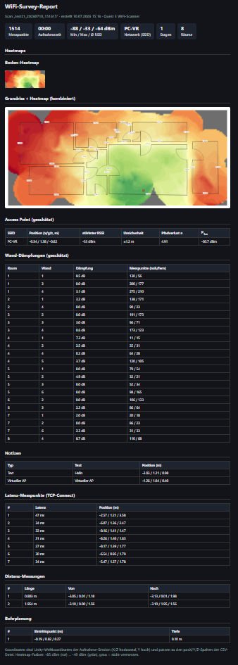
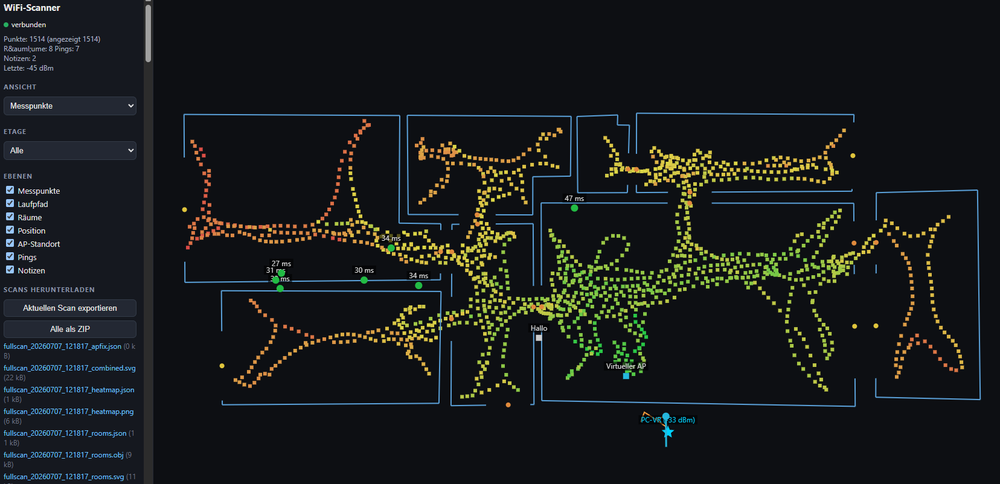

# Quest 3 WiFi-Scanner

Native Meta-Quest-3-App (Unity 6, **OpenXR + Meta-OpenXR/AR Foundation**),
die die WiFi-Signalstaerke (RSSI) des **verbundenen** Access Points ausliest
und mit der 3D-Kopfposition verknuepft. Beim Durchschreiten von Raeumen
entstehen im **MR-Passthrough**:

- eine **3D-Punktwolke** mit RSSI-Farben,
- eine **interpolierte Boden-Heatmap** (IDW) mit grauer Luecken-Anzeige fuer
  unvermessenes Gebiet,
- ein **manuell gezeichneter, massstaeblicher Grundriss** inklusive Raumhoehen,
  Tueren/Fenstern und optionalen Bohr-, Mess-, Ping- und Notiz-Markern,
- eine **Handgelenk-Minimap** und ein **Web-Dashboard** fuer Live-Ansicht,
- einen **lokalen bidirektionalen Durchsatztest** direkt gegen den Dashboard-Browser,
  Downloads und Scan-Export im lokalen Netzwerk.

Die App arbeitet ohne vorherigen Meta-Space-Setup-Raumscan. Virtuelle Punkte
und Heatmap koennen trotzdem dynamisch hinter realen Objekten verschwinden:
Die Occlusion laeuft ueber die Quest-Depth-API in Echtzeit.

> **Warum nativ und nicht WebXR?** Browser/WebXR haben keine API fuer
> WiFi-RSSI in dBm. Diese Information ist nur ueber native Android-APIs
> (`WifiManager`) erreichbar.

---

## Aktueller Funktionsumfang

- **Live-WiFi-Messung** des verbundenen APs: RSSI, Link-Speed, Frequenz, SSID,
  BSSID und Etage.
- **3D-Punktwolke** mit konstanter Punktdichte: nahe Punkte werden per
  laufendem Mittelwert aktualisiert statt dupliziert.
- **Boden-Heatmap** pro aktiver Etage: IDW-Interpolation, Lueckenraster,
  Deckkraft- und RSSI-Filter.
- **Multi-Etage**: Punkte werden beim Aufnehmen einer Etage zugeordnet. Unterstuetzt Kellergeschosse (KG), beliebige Etagenverschiebungen und filterbare Ansichten.
- **Manueller Raumzeichner**: Ecken setzen, Ecken verschieben, Raumhoehe
  ziehen, Boden kalibrieren.
- **Tueren/Fenster**: Wand-Oeffnungen werden in AR visualisiert, im SVG als
  Wandluecken markiert und im OBJ als echte Loecher in den Wandflaechen
  exportiert.
- **Grid-Ausrichtung**: Heatmap-Raster per Zwei-Controller-Linie an eine echte
  Wand ausrichten.
- **Dynamische Occlusion**: Environment Depth blendet Punkte und Heatmap hinter
  realen Objekten aus, ohne Raumscan.
- **Minimap** am rechten Handgelenk: Heatmap, Grundriss, Kopfposition,
  Blickrichtung, nordfest oder mit Blickrichtung rotierend.
- **HUD** am linken Handgelenk: REC-Status, Punktzahl, RSSI, SSID, Ansicht,
  Deckkraft und Legende.
- **Analysewerkzeuge**: AP-Standort-Schaetzung, TCP-Latenz-Punkte,
  raeumliche Notizen, Distanzmessung, Bohrplanung und universeller
  Loeschmodus.
- **Multi-AP-Support**: Gleichzeitige Standort-Schaetzung und Unsicherheits-Kreise fuer mehrere Access Points (BSSIDs).
- **Roaming-Tracking**: Erkennt BSSID- oder Band-Wechsel (z. B. in Mesh-Netzwerken) waehrend der Aufnahme, markiert diese als physisches Ereignis im Raum und exportiert sie.
- **Coverage-Simulation (Prognose)**: Echtzeit-Pfadverlust-Vorhersage basierend
  auf dem Grundriss (Raumwaende, Tueren/Fenster) und einem realen (fixierten)
  oder virtuell gesetzten AP.
- **Geiger-Audio**: optionales RSSI-Audiofeedback; staerkeres Signal erzeugt
  schnellere/hoehere Blips.
- **Session laden und ausrichten**: gespeicherte Scans koennen in der Quest
  wieder geladen und per realer Wand auf den aktuellen Tracking-Ursprung
  ausgerichtet werden.
- **Live-Streaming**: UDP zu `tools/receiver.py` und eingebettetes
  Web-Dashboard direkt von der Quest.

---

## Datenausgabe

Beim Export schreibt die App nach `Application.persistentDataPath`:

- `<stem>.csv` und `<stem>.json` mit allen Messpunkten
- `<stem>_heatmap.png` plus `<stem>_heatmap.json` mit Georeferenz
- `<stem>_rooms.svg` und `<stem>_rooms.json` fuer den Grundriss
- `<stem>_walls.svg` als Grundriss mit beschrifteten Wand-Daempfungen (in dB)
- `<stem>_coverage.png` plus `<stem>_coverage.json` mit der simulierten Coverage-Prognose
- `<stem>_roam.json` fuer aufgezeichnete Roaming-Ereignisse (BSSID-/Band-Wechsel)
- `<stem>_rooms.obj` fuer extrudierte Raumwaende mit Tuer-/Fensterloechen
- `<stem>_combined.svg` als kombinierte Heatmap+Grundriss-Ansicht
- optional `<stem>_drill.json`, `<stem>_apfix.json`, `<stem>_ping.json`,
  `<stem>_notes.json`, `<stem>_measure.json`
- `wifi_autosave.*` als periodisch ueberschriebene Autosave-Dateien

Das Web-Dashboard bietet zudem einen formatierten HTML Report, der alle Daten kombiniert visualisiert. Ein Beispiel des generierten HTML-Reports findest du hier:
[Beispiel-Report ansehen (HTML)](assets/Example-Report.html) oder als Vorschau:



Das Haupt-JSON enthaelt inzwischen auch `floors` und `gridYawDegrees`, damit
Scans spaeter mit Etagen und Rasterausrichtung wiederhergestellt werden
koennen. Aktueller Restpunkt: Drill-/Ping-/Notiz-/Mess-Sidecars werden zwar
exportiert, aber noch nicht wieder in die In-App-Session geladen.

---

## Projektstruktur

```text
Wifi-Scanner/Assets/
  Scripts/
    Sample.cs                     Messpunkt-Datenmodell (+ CSV/JSON)
    WifiReader.cs                 Android-WifiManager-Bridge (JNI)
    SampleCollector.cs            Aufnahme, Glaettung, Spatial Hash, Export-Fassade
    HeatmapColorMapper.cs         RSSI -> Farbe
    HeatmapLegend.cs              Farblegenden-Textur
    PointCloudRenderer.cs         3D-Punktwolke, Pooling, Filter, Etagenfilter
    FloorHeatmapRenderer.cs       Boden-Heatmap, IDW, Luecken, PNG-Export
    VisualizationModeController.cs Punktwolke / Heatmap / Beides
    FloorManager.cs               Etagenliste, Etagenwechsel, Etagenfilter
    RoomTracer.cs                 Grundriss, Ecken, Raumhoehen, Bodenkalibrierung
    OpeningTool.cs                Tueren/Fenster in gezeichneten Waenden
    GridCalibrator.cs             Raster an Wand ausrichten
    MinimapController.cs          Handgelenk-Minimap
    DynamicOcclusionController.cs Environment-Depth-Occlusion
    ControlPanel.cs               World-Space-Bedienpanel
    HudController.cs              Handgelenk-HUD
    RecordingControls.cs          A/B-Controller-Shortcuts
    OpacityControls.cs            Deckkraft per Stick
    SessionLoader.cs              Scans listen/laden/restreamen
    ScanAligner.cs                Geladene Scans auf reale Wand ausrichten
    GeigerCounter.cs              RSSI-Audiofeedback
    ApLocator.cs                  AP-Standort-Schaetzung
    PingTester.cs                 TCP-Latenz-Knoten
    SpatialNoteManager.cs         Raeumliche Notizen
    DistanceMeasurer.cs           Distanzmessungen
    DrillPlanner.cs               Bohrlinien auf Raumflaechen
    DeleteController.cs           Universeller Loeschmodus
    WebDashboardServer.cs         Eingebetteter HTTP/WebSocket-Server
    WebDashboardPage.cs           Self-contained Browser-Dashboard
    DataExporter.cs               CSV/JSON/PNG/SVG/OBJ-Export und Load-APIs
    NetworkStreamer.cs            UDP + WebDashboard-Fanout
    PassthroughSetup.cs           MR-Passthrough + Boundaryless
    SceneBootstrap.cs             Runtime-Erzeugung und Verdrahtung
    WifiProbe.cs                  Standalone-WiFi-Test
  PointMat.mat / FloorHeatMat.mat Material-Assets gegen Shader-Stripping
  Plugins/Android/AndroidManifest.xml Permissions + GameActivity

tools/
  receiver.py                     PC-GUI fuer Live- und Offline-Ansicht
  pull_scans.ps1                  Export-Dateien von der Quest ziehen
```

---

## Setup

### Voraussetzungen

- Unity 6000.0.x mit Android Build Support (+ OpenJDK, SDK, NDK)
- Pakete aus dem Manifest:
  `com.unity.xr.openxr`, `com.unity.xr.meta-openxr`,
  `com.unity.xr.arfoundation`, `com.unity.xr.interaction.toolkit`,
  `com.unity.xr.hands`
- Quest 3 / 3S im Developer Mode, USB-Debugging erlaubt

### Project Settings

Project Settings -> XR Plug-in Management -> **OpenXR -> Android**:
Feature-Gruppe **Meta Quest** aktivieren und diese Features anhaken:

1. **Meta Quest: Session**
2. **Meta Quest: Camera (Passthrough)**
3. **Meta Quest: Boundary Visibility**
4. **Meta Quest: Meshing**
5. **Meta Quest: Occlusion**

`Meshing` bleibt aktiviert, obwohl kein statischer Raum-Mesh-Scan mehr benutzt
wird: es sorgt fuer die `USE_SCENE`-Permission, die fuer die Depth/Occlusion-
Pipeline benoetigt wird.

### Szene

`Assets/Scenes/SampleScene.unity` ist vorbereitet: XR Origin, `SceneBootstrap`
mit Material-Assets und `PassthroughSetup`. Fuer UDP-Live-Streaming nur die
PC-IP am `SceneBootstrap` oder spaeter im Bedienpanel setzen.

### URP-Magenta-Falle

Zur Laufzeit per `Shader.Find` erzeugte Materialien verlieren im Android-Build
leicht ihre Shader-Variante und rendern magenta. Deshalb sind `PointMat` und
`FloorHeatMat` echte Material-Assets und werden am `SceneBootstrap` referenziert.

---

## Bedienung

Die App startet in Passthrough mit pausierter Aufnahme. Aufnahme wird bewusst
per A-Taste oder Panel gestartet.

### Controller

| Eingabe | Funktion |
|---|---|
| A (rechts) | Aufnahme Pause/Weiter |
| B (rechts) | Export |
| L-Stick hoch/runter | Deckkraft von Punktwolke + Heatmap |
| R-Stick hoch/runter | Minimap-Deckkraft |
| R-Stick-Klick | Ansicht wechseln: Punktwolke -> Heatmap -> Beides |
| Y (links) | Minimap ein-/ausblenden |
| Menue-Taste (links) | Bedienpanel ein-/ausblenden |
| R-Grip ueber dem Bedienpanel | Panel greifen und frei ablegen; es dreht sich danach automatisch zum Nutzer |
| Oeffnung/Notiz/Ping lange druecken | Werkzeugoptionen an der Hand oeffnen |
| Beide Grips nach "Grid ausrichten" | Wand-Kalibrierlinie uebernehmen |
| Zeichenmodus: Trigger / B / A | Ecke setzen / Raum schliessen / letzte Ecke zurueck |

Aktive Werkzeuge blockieren normale A/B-Belegungen dort, wo sonst
Fehlbedienungen entstehen wuerden.

### Bedienpanel

Das World-Space-Panel wird mit dem Controller-Strahl bedient.

**Aufnahme & Export**

- Export-Name
- PC-IP fuer UDP-Live-Stream
- Aufnahme / Export
- Neuer Scan mit Auswahl "Export + Neu" / "Ohne Export" / "Abbrechen"; die leere Session startet pausiert
- Punkte loeschen
- alle Scan-Dateien vom Geraet loeschen (Zwei-Klick-Bestaetigung)
- Scan-Auswahl, Scan laden (Zwei-Klick-Bestaetigung)
- Scan ausrichten
- Web-Dashboard an/aus plus URL-Anzeige

**Raum-Setup**

- Grid ausrichten
- Raum zeichnen
- Boden kalibrieren
- Raeume loeschen
- Bohrplanung
- Loeschmodus
- Tueren/Fenster
- letzte Oeffnung entfernen

**Etagen**

- aktive Etage wechseln: EG -> OG1 -> ... -> Alle
- neue Etage anlegen, wenn die Quest deutlich ueber der obersten bekannten
  Etage liegt

**Visualisierung**

- Ansicht wechseln
- dynamische Occlusion an/aus
- Minimap an/aus
- Grundriss in Minimap an/aus
- Kartenrotation
- AP-Standort an/aus
- Audio an/aus
- Deckkraft

**Messen & Notizen**

- Distanz messen
- Notizen setzen
- Ping-Testpunkte setzen
- jeweilige Elemente loeschen

**Filter**

- Farblegende
- RSSI-Min/Max-Filter, z. B. nur Schwachstellen unter -75 dBm anzeigen

---

## Raumzeichnen

Der Grundriss wird manuell in AR gezeichnet, ohne Space Setup:

1. **Raum zeichnen** aktivieren.
2. Mit dem rechten Controller nacheinander Ecken setzen.
3. Mit B schliessen oder nahe der ersten Ecke einrasten und per Trigger
   schliessen.
4. Fertige Raeume koennen im Zeichenmodus bearbeitet werden:
   - Ecke anvisieren und ziehen
   - Bodenflaeche anvisieren, Trigger halten und Raumhoehe ziehen

Raeume mit Hoehe werden als OBJ-Waende exportiert. Boden- und Deckenflaechen
werden bewusst nicht gekappt, damit auch komplexe/konkave Grundrisse robust
bleiben.

### Tueren und Fenster

Das Tool **Tueren/Fenster** arbeitet auf vorhandenen Waenden:

- Tuer: erste obere Ecke/Anschlagseite waehlen, zweite Aktion legt Breite fest,
  Hoehe geht automatisch bis zum Boden.
- Fenster: zwei gegenueberliegende Ecken des Rechtecks setzen.
- A wechselt zwischen Tuer/Fenster, B entfernt die letzte Oeffnung.

SVG-Exporte zeichnen Wandluecken mit Symbolen; OBJ-Exporte schneiden reale
Oeffnungen in die Wandgeometrie.

---

## Sessions Laden Und Ausrichten

Gespeicherte Scans koennen ueber das Panel wieder geladen werden. Geladen
werden:

- Samples
- Raeume inklusive Hoehen und Oeffnungen
- Etagen
- Grid-Yaw

Da die Quest ihren Tracking-Ursprung bei jedem Start neu setzen kann, liegen
alte Weltkoordinaten selten exakt auf der realen Umgebung. Dafuer gibt es
**Scan ausrichten**:

1. Einen geladenen Raum mit Hoehe anvisieren.
2. Wand aus dem geladenen Grundriss per Trigger waehlen.
3. Linken Controller an die reale Anker-Ecke halten.
4. Rechten Controller entlang der realen Wand halten.
5. Beide Grips halten, Vorschau pruefen, loslassen.

Die App rotiert und verschiebt die komplette Session inklusive Samples,
Raeumen, Etagen und Grid-Yaw.

---

## Web-Dashboard Und PC-Viewer

### Eingebettetes Web-Dashboard

Wenn aktiviert, serviert die Quest eine lokale Seite:

```text
http://<quest-ip>:8080
```

Das Dashboard zeigt live:

- Messpunkte oder clientseitige 2D-Heatmap
- Simulierte Coverage-Prognose (inkl. Waende und virtuellen/realen APs)
- Laufpfad und aktuelle Kopfposition
- Raeume mit Tueren/Fenstern
- AP-Standort (inkl. mehrerer BSSIDs)
- Roaming-Ereignisse
- Ping-Knoten
- Notizen
- Etagenfilter



Zusaetzlich bietet es:

- Scan-Liste
- Einzel-Downloads
- ZIP-Download aller Exporte
- Export-Trigger vom Browser aus

Hinweis: Das Dashboard ist fuer ein vertrauenswuerdiges lokales Netzwerk
gedacht. Es hat derzeit keinen PIN/Read-only-Modus.

### Python-Receiver

`tools/receiver.py` empfaengt denselben Live-Stream per UDP und zeigt 2D/3D-
Ansichten auf dem PC. Es verarbeitet auch Live-Raeume, Bohrlinien, AP-Fix,
Ping-Knoten, Notizen und Clear-Pakete beim Session-Reload.

---

## Daten Vom Geraet Holen

Per Skript:

```powershell
.\tools\pull_scans.ps1
```

Oder direkt per ADB:

```bash
adb pull /sdcard/Android/data/<package-name>/files/ ./
```

Das Web-Dashboard kann Exporte ebenfalls einzeln oder als ZIP herunterladen.

---

## Bekannte Risiken / Hinweise

- **WiFi-Permission:** `ACCESS_FINE_LOCATION` muss gewaehlt sein, sonst werden
  SSID/BSSID redaktiert und RSSI kann unbrauchbar sein (`<unknown ssid>`,
  `-127` dBm).
- **Android API:** `WifiManager.getConnectionInfo()` ist ab API 31 deprecated,
  funktioniert aber auf getesteten Quest-Systemen. Falls ein OS-Update das
  blockt, muss `WifiReader.cs` auf `ConnectivityManager` + `NetworkCallback` +
  `getTransportInfo()` umgestellt werden.
- **Tracking-Drift:** Bei langen Scans ueber mehrere Raeume kann Tracking-Drift
  auftreten. Waehrend einer Aufnahme nicht recentern. Fuer spaeter geladene
  Scans den Scan-Aligner verwenden.
- **RSSI-Rauschen:** RSSI schwankt mehrere dB. `smoothingWindow` glaettet, und
  revisited Punkte werden mit laufendem Mittelwert aktualisiert.
- **Multi-Etage:** Live-Heatmap und PNG-Export beziehen sich aktuell auf die
  aktive Etage. Separate Heatmap-PNGs pro Etage sind als Restpunkt offen.
- **Session-Reload:** Samples, Raeume, Etagen und Grid-Yaw werden geladen.
  Sidecars fuer Bohrlinien, Ping-Knoten, Notizen und Messungen werden aktuell
  nur exportiert, noch nicht wiederhergestellt.
- **Editor:** Passthrough, dynamische Occlusion und echte WiFi-Daten laufen nur
  im Android-Build. Im Editor liefert `WifiReader` Fake-Werte, damit UI,
  Punktwolke, Heatmap und Filter testbar bleiben.

---

## Naechste Sinnvolle Schritte

1. Sidecars (`_drill`, `_ping`, `_notes`, `_measure`) laden und beim
   Scan-Ausrichten mittransformieren.
2. Separate Heatmap-PNGs pro Etage exportieren.
3. Das inzwischen lange Bedienpanel in Tabs oder kompakte Werkzeugseiten
   aufteilen.
4. Optionaler PIN/Read-only-Modus fuer das Web-Dashboard.
